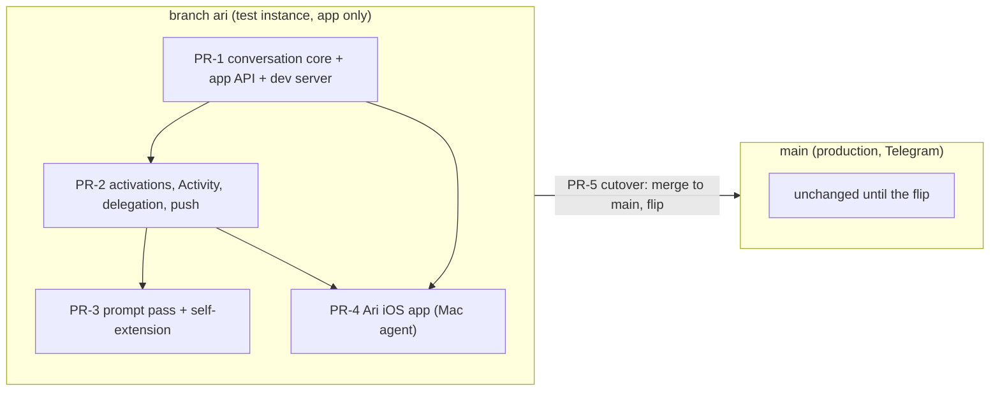
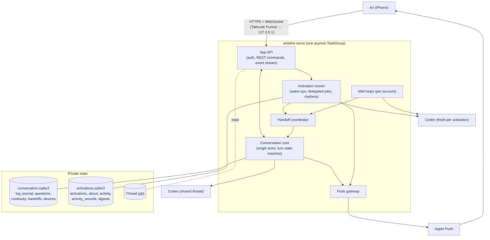

# Ari: implementation plan

Status: agreed 2026-10-11; PR-1 implemented. Each later PR is reviewed on its own.

## Outcome

Iris moves from Telegram to **Ari**, a native iPhone app. The underlying system is rebuilt around three building blocks:

- **Thread** — durable meaning (unchanged).
- **Activation** — every time Iris wakes, whoever or whatever triggered it.
- **Conversation** — one voice, independent of any surface.

That gives Ari four things Telegram couldn't:

- background jobs you can watch and stop;
- an Activity trail that makes quiet work visible;
- Goals and Library views over the Thread;
- notifications whose interruption level Iris chooses.

## How the work runs



- **Production keeps running today's `main` (Telegram)** until the flip, untouched.
- **All new work lands on an integration branch `ari`** through draft PRs that you review on GitHub. A test instance on the home server runs `ari`.
- **Telegram is deleted on `ari` in PR-1**, not ported onto the new core. The rollback during the two-week settling period is "redeploy the `telegram-final` tag". The old state files are never modified, so that rollback stays real.
  - This still delivers "one surface at a time" and avoids roughly 600 lines of throwaway porting.
  - It also removes every dual-name and compatibility shim.
- **Server PRs are long and complete.** The iOS app starts as soon as PR-1 publishes the API contract and the dev server; PR-2 adds real data behind fixture-backed endpoints the app is already using.

## Target architecture



Engineering bar, since the server is the part that has to be built really well:
- strict typing; pydantic models at every wire boundary;
- structured concurrency: one TaskGroup, with blocking git and sqlite work moved to threads;
- a single writer per state machine, with durable state committed *before* anything is broadcast;
- idempotent commands;
- explicit restart recovery for every lifecycle;
- integration tests through the real API.

## PR-1 — Conversation core, app API, dev server (server, here)

**Goal.** Everything the app needs to hold the conversation, against a real server or the dev server, plus a checked-in contract the Mac agent builds from.

**Conversation core** — a new `src/ariadne/conversation/`, built from logic currently trapped in the Telegram adapter:

- `ConversationCore` is the only owner of the shared `CodexConversation`.
  - One inbound actor (an asyncio queue) serialises every command: send, steer, stop, answer, react, and handoff turns.
  - Turn state machine: idle → running → waiting_input → stopping.
  - A persisted input queue, so steering survives a restart.
  - This fixes two live bugs by construction:
    - a race that can run two turns at once `[telegram/bot.py:1516-1524]`;
    - a `finally` block that can wedge the conversation forever `[telegram/bot.py:1492-1505; handoff/state.py:271-272]`.
- **Projector:** turns Codex events into outbound events. It reuses the activity stack, phase rules and silent-handoff policy from `telegram/live.py` and `telegram/proactive.py`.
- **Log:** a server-assigned message `id`, a unique `client_message_id` for idempotent retries, `turn_id`, `kind`, `phase`, `origin`, attachments, and reactions. It is the single commit point.
  - Telegram history is not imported: the Thread is the memory that matters, and the conversation starts fresh at the flip.
- **Journal and bus:** events carry `(boot_id, seq)`.
  - A client that reconnects gets a snapshot plus committed events after its cursor.
  - Streaming deltas are never replayed.
- **Questions:** the MCP tool writes a row and waits; the core presents it.
- **Files:** `share_files` delivers directly to the app, with no approval card.
- Attachments, continuity, and status data move over from `telegram/*` mostly intact.

**Model-facing renames** (prompts get only the minimal edits here; the full rewrite is PR-3):

| Today | After |
|---|---|
| `read_recent_telegram_messages` | `read_recent_conversation` |
| `ask_telegram_question` | `ask_question` |
| `request_telegram_file_delivery` | `share_files` |
| `hand_off_to_telegram_conversation` | `hand_off_to_conversation` |
| `send_telegram_message` (unused) | deleted |
| `TELEGRAM_*`, `ARIADNE_TELEGRAM_STATE`, profile `telegram` | `ARIADNE_CONVERSATION_STATE`, profile `conversation` |
| "Telegram …" in the MCP server instructions, error strings, `telegram.md`, activation text | neutral wording; `{{ human }}` instead of hard-coded "Divy" |

**App API** — a new `src/ariadne/app/`:

- **Framework.** Starlette + uvicorn are already locked as transitive dependencies; declare them explicitly. FastAPI is fine if it resolves cleanly against the lock. The implementer chooses, but either way the result must be a **checked-in OpenAPI / JSON Schema contract** with a CI drift check.
- **`serve` refactor.** It becomes `asyncio.run(serve(runtime))` with one TaskGroup.
  - `build_runtime(settings, codex_client_factory, push_gateway, clock)` creates the seams the tests and dev server need.
  - A uvicorn `Server` subclass with no signal capture, so shutdown can close Codex and flush telemetry.
- **Auth.** One bearer token per paired phone; only its SHA-256 is stored; checked with `hmac.compare_digest`.
  - It must be **pure ASGI middleware**, because Starlette's `BaseHTTPMiddleware` skips WebSockets.
  - `ariadne-app pair` prints the token once, plus a TOML snippet to paste. No access log; headers redacted.
- **Binding** is loopback only (`127.0.0.1`), enforced by config validation. Funnel proxies to it.
- **Limits.** JSON bodies ≤ 64 KiB. Attachments arrive as a streamed `PUT`, reusing the existing size caps and filename reservation. `ws_max_size` around 256 KiB, plus app-level heartbeats.
- **Contract sketch.** The implementer decides the final shape, and the generated schema is the source of truth.
  - **Stream:** `GET /v1/stream?after=<seq>` (WebSocket, server→client only). Events:
    - `Snapshot`
    - `TurnStarted`, `TurnFinished{completed|stopped|failed|silent}`
    - `WorkSummary`, `ActivityChanged`, `SpeechDelta`, `MessageCommitted{…, notify}`
    - `InputAccepted{disposition}`, `QuestionAsked/Settled`, `ReactionsChanged`
    - `StatusChanged`, `ActivationUpdated`, `ActivityAppended`, `ConversationReset`
  - **Commands (REST):**
    - `POST /v1/messages{client_message_id, text, attachment_ids, reply_to_id, voice}`
    - `POST /v1/turn/stop`
    - `POST /v1/questions/{id}/answer`
    - `PUT /v1/messages/{id}/reactions`
    - `PUT /v1/attachments`
    - `POST /v1/conversation/new`
    - `PUT /v1/settings`
  - **Reads:**
    - `GET /v1/messages?before=`
    - `GET /v1/identity` (agent name and avatar come from the instance)
    - `GET /v1/status`
    - `GET /v1/upcoming`, `GET /v1/activity`
    - `GET /v1/goals`, `GET /v1/library?folder=`, `GET /v1/records/{id}`
    - `GET /v1/files/{id}`
  - **Devices:** `POST /v1/devices`, `POST /v1/live-activities`.
- **Thread reads** use `KnowledgeStore.list_folder`/`read` `[knowledge/store.py:190-262]` in a thread. Record bodies go out as raw Markdown and the app renders them.

**Dev server** — the `ariadne-dev-server` console script, kept separate from the model-facing CLI. It runs the *real* `serve` with:

- temporary state, seeded with behaviour-scenario fixtures (people, goals, plans, calendar, history);
- `ScriptedCodex`: a fake client promoted from the test fakes `[tests/test_codex.py:180-375]` and driven by YAML scripts (reasoning summary, activity, commentary/final deltas, ask, fail, wait-for-stop/steer);
- a dev token printed at startup and a recording push gateway at `/dev/pushes`;
- `/dev/trigger/{proactive,question,job-progress,failure}`, a frozen-clock option, and `--host 0.0.0.0` for testing on a physical device.

It runs on macOS with `uv` and git and needs no credentials.

**Also in PR-1:**
- Fix the bug where an activation key is reused across attempts: discard any staged handoff on recovery, or key handoffs per attempt `[revisit/state.py:59-68; handoff/state.py:158-170]`.
- Delete `src/ariadne/telegram/`, `mcp/telegram.py`, the Telegram parts of `service.py`/`config.py`/`scripts/bot_profile.py`, the python-telegram-bot dependency, and the Telegram tests. The specs worth keeping are ported first (below).
- Config:
  - a new `[app]` section (+ `[app.apns]` and `[[app.devices]]` with `token_sha256`);
  - a new `[conversation].state` that defaults to the existing database file;
  - `[telegram]` is rejected with an explicit "retired" error.

**Tests.** An integration harness writes a temporary TOML file and a seeded git Thread, starts the real `serve` on `127.0.0.1:0` with `ScriptedCodex`, and drives it with `httpx` + `websockets`. It ports roughly fifteen conversation specs from `tests/test_bot.py`:
- steering order;
- questions answered by tap or by text;
- stop with partial speech;
- input that arrives before the turn handle exists;
- handoffs, both in a direct batch and as a quiet-window proactive turn;
- settings changes while busy;
- recovery after a failure;
- reconnect-and-resume;
- idempotent send;
- history paging.

Unit tests only for tricky pure logic.

**Acceptance:**
- the integration suite is green;
- the dev server runs on a Mac with no credentials;
- the contract is generated and checked in;
- `ruff`, `mypy --strict` and `pytest` all pass.

## PR-2 — Activations, Activity, delegation, push (server, here)

**Activation store and runner** — a new `src/ariadne/activation/`:

- **Storage.**
  - Rebuild `revisits` into `activations`: kind `wakeup|delegated|daily|weekly`, title, note, attention, `due_at`, `not_after`, status (adds `stopped|cancelled|expired`), attempts, origin, a unique `dedupe_key`, `stop_requested_at`, `lease_until`.
  - An `activation_about` table.
  - Keep the path and existing ids. Migrate with `user_version`, in the same style as `MailState`.
- **Runner.** `ActivationRunner(max_parallel=3)`.
  - Deep and delegated jobs may use at most two slots, so light, focused and rhythm work never queue behind a long job. Today one deep revisit blocks everything `[revisit/runtime.py:164-181]`.
  - Each attention level gets a time limit, enforced as timeout → interrupt → failed.
  - Leases prevent two processes from running the same activation.
- **Stop.** `ActivationControl.stop(id)` writes `stop_requested_at` durably, then interrupts.
  - The result is `stopped`, which is final and discards the staged handoff. If the interrupt doesn't land within a grace period, the task is cancelled.
  - Stopping a pending job means `cancelled`.
  - Today a stop would be logged as a failure, and stewardship would retry it `[codex/conversation.py:75; revisit/runtime.py:137]`.
- **Rhythms.** A planner creates one instance per period, `daily:<local date>` and `weekly:<ISO week>`, each with a `not_after`. Every stewardship guarantee is kept:
  - at most one completed cycle per day;
  - the waking window, DST included;
  - no replay of missed days;
  - a 30-minute retry after failure, inside the window only;
  - pause / pause-until persisting across restarts;
  - "run now" bypasses the gates.
- **One-time migration.** Import `stewardship.sqlite3` once: pause state, broad attention, today's completion, and the recent summary as starting context. The old file is left untouched.
- **Deleted:** `RevisitLoop`, `StewardshipLoop` (its next-expected calculation is kept), `mcp/stewardship.py`, the stewardship environment variables, and the separate background profiles, which collapse into one family.

**Tools:**
- **`schedule_wakeup(note, attention, at=None, title=None, about=None)`**
  - Leaving out `at` means *start now in the background*: delegation.
  - "Now" is refused from background activations, so jobs can't fan out, and each activation can create only a few jobs.
  - `list` / `update` / `cancel` stay.
- **`record_outcome(account, about=None, broad_attention=None)`** is turn-scoped in every background profile and replaces `record_stewardship_outcome`.
  - `record_current_mail_decision` stays, because it carries typed mailbox actions.
- **`read_activity(since, until, about=None)`** is available in every profile. This is Iris reviewing her own behaviour `[docs/companion-direction.md:166]`.
- **`hand_off_to_conversation(text, urgency)`**, where urgency is `passive|active|time_sensitive`. This is how Iris picks the notification level.

**Activity:**
- **One helper writes it.** `finish_activation(outcome)` runs at the commit boundary: scheduler state → handoff release or discard → Activity row. It's called from the runner, the mail processor and the conversation core.
  - The row is inserted at claim time, so a crash is still visible.
- **Outcomes:** `spoke|handed_off|quiet|failed|stopped|skipped`.
  - "Handed off" is recorded only when release returns a `ready` row.
  - "Spoke" requires that the proactive turn really sent something.
- **Effects** are collected per turn inside `stream_turn` `[codex/conversation.py:429-456]`:
  - **MCP calls are reliable:** arguments plus status. Ids of newly created records come from the item result; verify the field name.
  - **Mutating `ariadne` CLI commands** (calendar create/update/delete/respond, mail draft) write their own journal row, keyed by an activation id injected into the turn's shell environment. Parsing shell strings is unreliable `[codex/activity.py:146-160]`.
  - Effects are labelled "observed", not "complete": shell edits and browser actions are blind spots.
- **Iris's account.**
  - If she forgets `record_outcome`, fall back to her final answer, then to a line derived from the effects. Record where the account came from, and count misses in telemetry.
  - A delegated job that ends with no handoff gets a minimal one from the runtime, so your request is always closed.
  - Chat turns get a row only when they changed something, with a derived account and no tool call.
- **Retention:** 90 days; digests are kept. **Failures** set a status marker and get a row.

**Weekly digest:**
- A Sunday 19:00 rhythm.
- It reads that week's Activity, the Thread and the conversation.
- `record_weekly_digest(markdown)` is committed at the boundary to a digests table and as a Thread record, proposed under `reflection/weekly`.
- Passive push.

**Push** — `src/ariadne/app/push.py`, with `httpx[http2]` as the one new dependency; `pyjwt[crypto]` is already locked:
- **Auth:** an ES256 JWT, cached for about 45 minutes.
- **Device tokens:** stored per environment (Xcode builds use the sandbox, TestFlight uses production). Error handling covers 410, an expired token and 429.
- **Interruption levels:**

  | Message | Level |
  |---|---|
  | Proactive turn | Highest urgency among its handoffs |
  | Direct reply | Active, and only when no live socket is open |
  | Question | Active |
  | Digest | Passive |

- **Live Activities** cover delegated jobs only. The app starts the Live Activity and registers its push token; the server sends updates (the latest safe activity label, priority 5) and the end event.
- **The serve process is the only sender.** MCP tools only write rows.

**API additions:**
- real `upcoming`, `activity`, and `POST /v1/activations/{id}/stop`;
- Goals gain "next" and "last / quiet N days" via joins on `activation_about` / `activity_records`;
- device and Live Activity registration.

**Acceptance.** Integration tests using a frozen clock and a fake APNs server on loopback:
- parallel slots and the deep-job cap;
- stop before start, mid-turn, and racing completion;
- restart recovery;
- every rhythm guarantee;
- Activity rows for quiet and failed outcomes;
- effect capture;
- the APNs JWT, headers, interruption levels and Live Activity payloads;
- 410 cleanup.

The dev server exposes all of this with fixtures.

## PR-3 — Prompt pass and self-extension (here, with runs on the home server)

- **Baseline first.** On the home server, which has Codex auth, run the behaviour lab on the key scenarios and keep the reports:

  ```bash
  uv run python -m ariadne.scripts.behavior run <id> --output …
  ```

- **Rewrite** for brevity and focus, against the final tool surface:
  - `base`, `grounding`, `companion`, `conversation` (replaces `telegram.md`), `knowledge`.
  - One shared **background** document instead of repeated rules in `mail`/`revisit`/`stewardship`.
  - New guidance: delegation (inline vs background), urgency, `record_outcome`, `read_activity`, the digest.
  - Principles over enumerations. Worked examples move into scenarios. Add only what fixes an observed failure `[docs/companion-direction.md, slice 6]`.
- **New scenarios:**
  - a long request becoming a background job;
  - a quick request staying inline;
  - choosing urgency;
  - a quiet outcome being recorded;
  - a friction-to-issue proposal with personal details scrubbed.
- **Self-extension.**
  - Operator setup: a fine-grained GitHub token for `TGDivy/ariadne` (issues, pull requests, contents), `gh auth login --with-token` on the server, and a clone of the repo in Iris's workspace. `github.com` is already on her network allowlist `[profile.py:28-30]`.
  - Prompt rules: file evidence-led issues scrubbed of personal details; draft PRs only for small, well-understood changes; never merge or push to `main`; mention it through a handoff.
- **Acceptance:** you review the before/after reports; existing scenarios don't regress.

## PR-4 — Ari iOS app (Mac agent)

This is handed over as a separate self-contained brief (`ari-ios-handoff.md`).
- It builds against the PR-1 contract and dev server first, then the test instance.
- iOS 26 SwiftUI under `apple/`, laid out like Ithaca.
- Dark-first, native Liquid Glass; the iridescent iris is the only colour.
- A fixture-driven design-preview gallery supplies the screenshots you review.

## PR-5 — Cutover

1. **Test instance on the home server**, using:
   - its own config, state directory and Codex login;
   - a copy of the Thread pushing to a local bare remote (never the real Thread);
   - Funnel on a separate port.

   Run the end-to-end checklist on the physical iPhone, including push and the Live Activity.
2. **Funnel.** Check the plan in the admin console, then `tailscale funnel --bg --https=443 http://127.0.0.1:<port>`. If Funnel isn't available, use `cloudflared`.
3. **APNs key** (`.p8`) and the bundle identifier, in the private config.
4. **Flip:**
   - tag `main` as `telegram-final`;
   - merge `ari`; deploy; pair the phone;
   - the conversation starts fresh: no history import, and a new Codex thread.
5. **After about two weeks** of real use: delete the rollback notes, and update `README`, `docs/architecture.md`, `docs/companion-direction.md` and the operations docs.

## Testing strategy

- **Integration first.** The real `serve` over HTTP/WebSocket with `ScriptedCodex`, a frozen clock, a fake APNs server and a seeded Thread.
- **Keep** the behaviour-level suites: config, CLI, knowledge, calendar, mail, health, browser, handoffs (state), MCP (in-memory), most of codex, prompts and profiles (renames updated).
- **Delete** Telegram-coupled tests after porting their specs.
- **Behaviour lab** for judgement; it never runs in CI.
- **CI** adds: the explicit dependencies, the schema drift check, a dev-server smoke test as a subprocess, and `asyncio.timeout` guards.

## Deferred (with the trigger to revisit)

- **A stronger authority fence**, before checkout-type actions or the shared server:
  - Iris's sandbox can reach `localhost` and write anywhere under `$HOME`, which includes `[app.devices]` and the state files;
  - fix: a separate Unix user, or auth state outside the writable roots.
- **Approval-card UI** for high-stakes browser actions (Waitrose): when grocery shopping lands.
- **Push privacy:** Apple sees notification text, as Telegram sees messages today. Option: a generic alert plus a Notification Service Extension that fetches the content.
- **Artifact files** (dashboards, snapshots), side chats, Ideas, Mac/iPad clients, health data in Ari, location-based wake-ups.
- **The shared server** (one instance per person, a push-key decision): when the box exists.
- **Tuning stewardship:** once Activity shows what it actually does.
- **Mail's uncapped retry loop** `[mail/runtime.py:1278-1285]`: give it backoff when its Activity rows show the cost.

## Risks

| Risk | Mitigation |
|---|---|
| Renaming tools changes behaviour | Behaviour-lab runs before and after (PR-3); a fresh Codex thread at cutover |
| Funnel's idle and bandwidth limits are undocumented | Heartbeats; a resumable stream; measure on the test instance |
| Three parallel deep turns cost more | The deep-job cap, per-attention time limits, usage telemetry per activation |
| Stop can't undo effects already committed | The Activity row lists the observed effects, so you can see what landed |
| One browser job at a time; knowledge writes queue behind git | Truthful busy state already exists; the runner treats contention as a normal wait |
| A migration bug loses scheduled work | Migrations are forward-only into new tables or files; old files stay for rollback |
